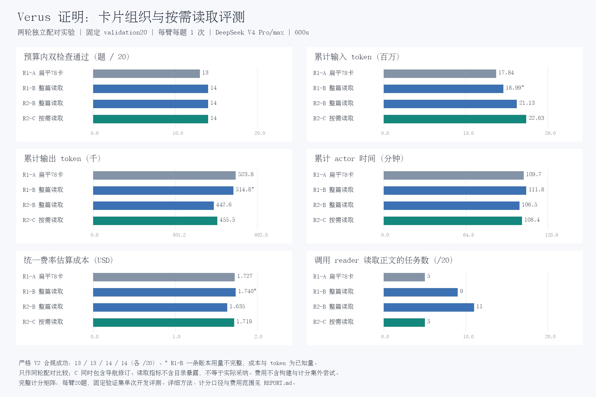

# Card Organization Experiments (2026-10-14)

Start with the **[English evaluation report](evaluation/REPORT.md)**. It explains
the fixed settings, A/B/C variants, and the two task-outcome comparison tables.
[Resource statistics and caveats](evaluation/DETAILS.md) accompany the
[80 episode rows](evaluation/episodes.csv) and [aggregate metrics](evaluation/metrics.json).



## Evaluated Skill Packages

| Package | Main file | Reading behavior |
|---|---|---|
| A: repaired78 flat baseline | [A SKILL.md](skills/A-flat78/SKILL.md) | Optional individual card reading from a flat index. |
| B: grouped references | [B SKILL.md](skills/B-grouped/SKILL.md) | 37 references containing 72 consolidated rules; a read returns the whole reference. |
| C: selective references | [C SKILL.md](skills/C-selective/SKILL.md) | Same rule bodies, with internal selection and revised navigation cues/Scope descriptions. |

R1 compares A/B; R2 compares a fresh B/C. All four arms use the same validation20
tasks, one episode per task, DeepSeek V4 Pro/max, and a 600-second actor budget.
The B packages in both rounds are byte-identical. C is a combined navigation and
reading-interface intervention, not a pure reading-granularity ablation.
Budgeted successes are 13/14/14/14; strict V2-compliant successes are 13/13/14/14.
These small, single-repeat experiments do not establish a reliable advantage.

Example: compare the [B lemma-bridge reference](skills/B-grouped/references/direct-existing-lemma-bridge.md)
with the [C lemma-bridge directory](skills/C-selective/references/direct-existing-lemma-bridge.md).
From the repository root, the frozen readers can be exercised without API calls:

```bash
python3 research_artifacts/card-organization-20261014/skills/B-grouped/reference_read.py direct-existing-lemma-bridge
python3 research_artifacts/card-organization-20261014/skills/C-selective/reference_read.py direct-existing-lemma-bridge
python3 research_artifacts/card-organization-20261014/skills/C-selective/reference_read.py direct-existing-lemma-bridge --rules original-card-003
```

## Methods and Provenance

- [Clustering/reduction plan and prompts](../../research_memory/projects/verus_self_evolving/experiments/20261011-trace2skill-card-organization/PLAN.md)
- [Selective-reading design](../../research_memory/projects/verus_self_evolving/experiments/20261013-selective-reference-reading/PLAN.md)
- [Navigation review](../../research_memory/projects/verus_self_evolving/experiments/20261013-selective-reference-reading/ROUTING_REVIEW_V2.md)
- [Lost-task reading audit](../../research_memory/projects/verus_self_evolving/experiments/20261013-selective-reference-reading/LOST_TASK_READING_AUDIT.md)
- [Router output](construction/router.json) and [normalization decisions](construction/router_normalization.json)
- Frozen settings, TASK, source-task hashes, schedules, environment deviations,
  and selected result summaries: [round 1](contracts/round1/) / [round 2](contracts/round2/).

The three `skills/` packages are copied byte-for-byte from the evaluated bundles,
including their readers and manifests. Historical runtime hashes remain evidence
of the original execution, not promises that a fresh environment matches them.
[PUBLICATION_MANIFEST.json](PUBLICATION_MANIFEST.json) records original and
published file hashes. Metadata paths use symbolic placeholders such as
`${VERUS_SKILL_RUN_ROOT}` and `${REPO_ROOT}`; these are documentation placeholders,
not automatically expanded runnable configs. Repeated per-episode workspace
inventories and skill manifests are omitted from the compact summaries; scoring,
usage, and retrieval fields are retained. Metric source hashes identify the
original, pre-normalization summaries.

Verify the published packages and recompute the aggregate statistics without
calling a model:

```bash
PYTHONPATH=src:skillopt-verusage/src:skill-evolution-pilot/src:scripts \
  python3 scripts/verify_card_organization_publication.py
```

To run new paid episodes, configure local tool/data/environment paths and use the
prepare/check/run stages in `scripts/evaluate_card_organization.py` and
`scripts/evaluate_selective_references.py`; continuation scripts preserve the
original selection and budget accounting. Do not treat these archived contracts
as authorization to spend money or replay them as live contracts without renewed
preflight checks. The figure generator expects the original local run layout;
the published CSV/metrics and verification script are the portable evidence.

This publication excludes credentials, environment files, sealed task data,
provider request/response payloads, and complete raw run directories. Original
local runs and the original working tree remain unchanged. Raw traces are not
included, so the qualitative reading audit is documented but cannot be fully
replayed from this compact publication alone.
